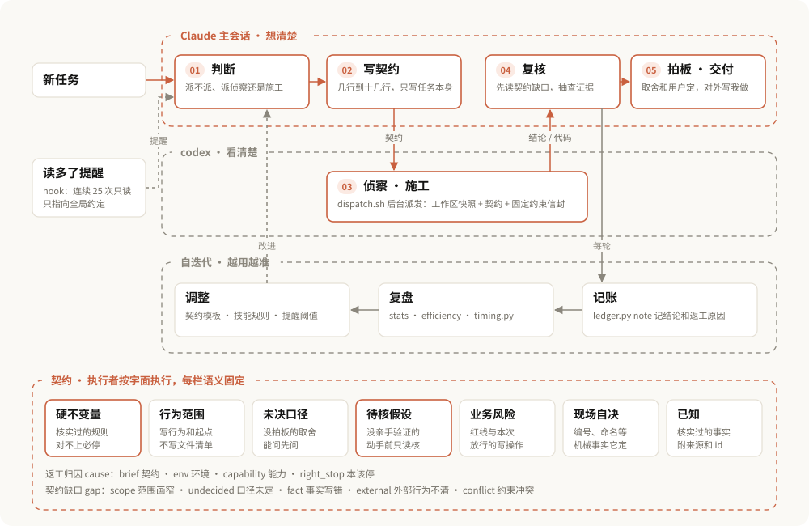
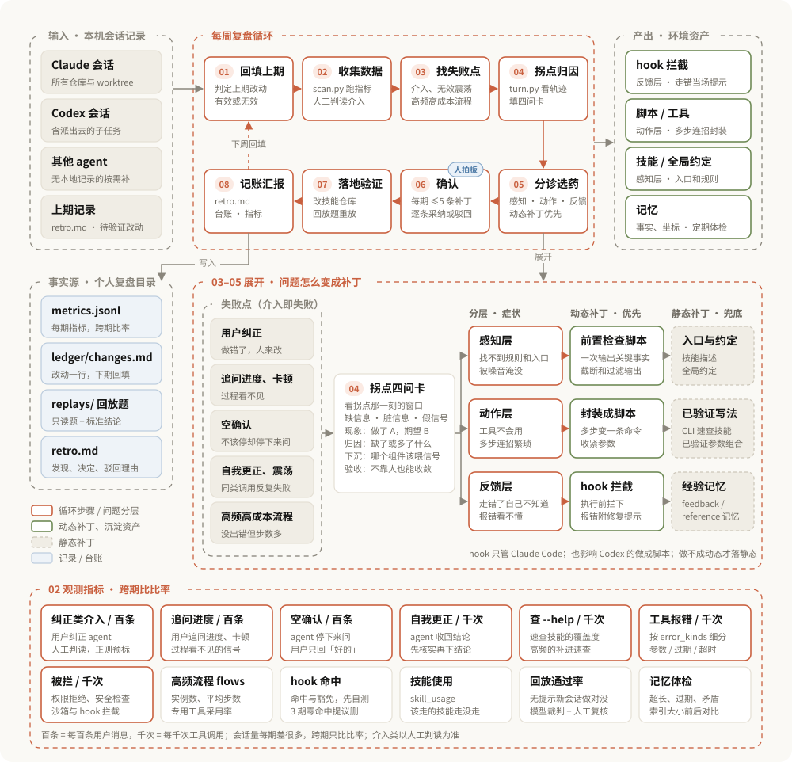

# rstack

两个让 coding agent「越用越准」的技能，加上配套的 hook。从一套日常在用的个人技能里抽出来，只留框架和思路。

| 技能 | 一句话 | 解决什么问题 |
|---|---|---|
| [`claude-lead`](skills/claude-lead/SKILL.md) | Claude 当主管，codex 当执行者 | 主会话上下文最贵，却把大量时间花在翻文件、跑测试上 |
| [`weekly-retro`](skills/weekly-retro/SKILL.md) | 每周复盘会话记录，把 agent 的错误变成环境资产 | 同样的错这周纠正了，下周换个会话还会再犯 |

两者是一个闭环：claude-lead 每次派发都记账；weekly-retro 每周扫描所有会话、在失败拐点归因，产出的补丁（hook、脚本、技能、约定）
反过来改进包括 claude-lead 在内的整个环境。

## claude-lead：Claude 当主管，codex 当执行者

<p align="center"></p>

- **委派省的是缓存读**：主会话的开销大头不是输出，而是上下文越大、轮数越多就越贵的缓存读。所以要移出去的是读文件和调试的轮次。
- **执行者看清楚，主管想清楚**：流水线是「侦察 → 拍板 → 施工」，实现只在想清楚之后才派。
- **返工几乎都是契约的锅**：最常见的是范围画窄。契约按栏写，每栏语义固定；没核实过的规则写成待核假设，不写成硬不变量。
- **按时机触发，hook 兜底**：技能描述写「什么任务、什么时刻该派」，不指望模型事先估出工作量；连续只读太多时 hook 再提醒一次。

设计取舍和每条规则的来由见 [DESIGN.md](skills/claude-lead/DESIGN.md)。

## weekly-retro：把 agent 的错误变成环境资产

<p align="center"></p>

- **怪环境，不怪模型**：结论要落到「那一刻缺了什么信号、多了什么噪音、哪个工具误导了它」。
- **介入即失败**：用户纠正或追问进度，都说明环境有缺陷；拍板、补需求不算。
- **只做有复利的修补，先看轨迹再动手**；能做成 hook、脚本的不写成文档。
- **补丁要能验收**：每条配一道只读回放题，全新会话、不给提示，看能否自己做对。
- **复盘本身也被复盘**：每两期看一次介入率、改动有效率、动静比、hook 误拦率和采纳率。

方法论和踩过的坑见 [DESIGN.md](skills/weekly-retro/DESIGN.md)。

## 支持的 harness

| 技能 / 组件 | Claude Code | Codex | Antigravity（agy） |
|---|---|---|---|
| `claude-lead` | ✅ 主会话（派发给 codex） | ➖ 不安装：它本身就是执行者 | ➖ 不安装 |
| `weekly-retro` 技能 | ✅ | ✅ | ✅ 安装到 `~/.gemini/config/skills` |
| `scan.py` / `turn.py` 读会话 | ✅ `cl:` | ✅ `cx:` | ✅ `ag:`，排除子代理会话（`nesting_depth > 0`） |
| `replay.py` 回放 | ✅ 回放执行者是 Codex，与发起方无关 | ✅ | ✅ |
| hooks（守卫、委派提醒） | ✅ | ➖ | ➖ |

agy 的会话从 `<brain>/<conversationId>/.system_generated/logs/transcript_full.jsonl`（没有就读 `transcript.jsonl`）读，
工作区和子代理层级从 brain 上一层的 `conversation_summaries.db` 只读取（缺失时照常扫描，只是覆盖统计里没有工作区、不排除子代理）。
默认扫 `${GEMINI_HOME:-~/.gemini}/*/brain`；别的宿主（如 T3 Code 的 antigravity provider）放在别处的 brain 目录，
用 `AGY_BRAIN_DIRS`（冒号分隔）或私有 `retro.json` 的 `agy_brain_dirs` 补上，支持 `~` 和通配符。

## 安装

需要 [Claude Code](https://docs.claude.com/en/docs/claude-code)、已登录的 [Codex CLI](https://github.com/openai/codex)、Python 3.9+、Bash 和 Git。
派发还需要 GNU coreutils 的 `timeout` 或 `gtimeout`（macOS：`brew install coreutils`）。

```bash
bash install.sh            # 软链技能，已有同名技能时跳过
bash install.sh --hooks    # 可选：把 hook 合并进 Claude Code 设置，先备份
```

- 软链安装：`weekly-retro` 装到 `~/.claude/skills`、`~/.codex/skills` 和 agy 的 `~/.gemini/config/skills`；`claude-lead` 依赖 Claude Code 主会话，
  只装到 `~/.claude/skills`（旧版装到 Codex 的那条软链会被清掉）。遵循 `CLAUDE_CONFIG_DIR`、`CODEX_HOME`、`GEMINI_HOME`；
  `CLAUDE_SKILL_DIR` / `CODEX_SKILL_DIR` / `AGY_SKILL_DIR` 可指定其他目录，设为空字符串就跳过那一边。
- 自动初始化私有目录 `$RSTACK_HOME`（默认 `~/.rstack`，权限 700），并给本仓库装提交前脱敏检查（git pre-commit hook，已有别的 pre-commit 时只提示不覆盖）。
- 把 [`global/AGENTS.example.md`](global/AGENTS.example.md) 里需要的规则合并进你的全局约定（Claude Code 读 `CLAUDE.md`，Codex 读 `AGENTS.md`），然后新开会话。
- 扫描和 hook 开箱可用。要定制，把示例复制进 `$RSTACK_HOME/config/` 再改（见下文「公开与私有」）。

常用环境变量：

| 变量 | 作用 | 默认 |
|---|---|---|
| `MODEL` / `EFFORT` / `SERVICE_TIER` | dispatch.sh 用的 codex 模型、推理强度、服务档 | codex 配置 / medium / codex 默认 |
| `TIMEOUT` | 单次派发超时（秒） | 1800 |
| `DELEGATE_WRITABLE` | 派发时长期放行的可写目录（CLI 登录态、构建缓存） | 无 |
| `NUDGE_THRESHOLD` | 委派提醒阈值（连续只读次数） | 25 |
| `RSTACK_HOME` | 私有根目录：配置、复盘产物、运行日志 | `~/.rstack` |
| `RSTACK_RULES` | 守卫规则文件 | `$RSTACK_HOME/config/guard_rules.json`，没有就用内置示例 |
| `RETRO_DIR` | 复盘记录目录 | `$RSTACK_HOME/retro` |
| `RETRO_CONFIG` | scan.py 配置文件 | `$RSTACK_HOME/config/retro.json` |
| `AGY_BRAIN_DIRS` | scan.py / turn.py 额外扫描的 agy brain 目录，冒号分隔，支持通配符 | 无（默认已扫 `${GEMINI_HOME:-~/.gemini}/*/brain`） |
| `AGY_SKILL_DIR` | install.sh 安装 agy 技能的目录，空字符串跳过 | `${GEMINI_HOME:-~/.gemini}/config/skills` |
| `REPLAY_MODEL` | 回放和裁判用的模型 | codex 默认 |

## 上手

1. 在 Claude Code 里调用 `/claude-lead`，挑一个只需读文件的任务走一次派发，复核后用 `ledger.py note` 记账。
2. 调用 `/weekly-retro`。首期看最近七天：先确认扫描覆盖范围，再从 `turns.tsv` 挑出需要修补的失败点。
3. 用合成题试跑回放，确认 Codex 能被调起：

   ```bash
   python3 -I skills/weekly-retro/scripts/replay.py --example --out "$(mktemp -d)"
   ```

4. 之后每周复盘一次，每条采纳的补丁在 `$RETRO_DIR/replays/` 写一道回放题。

## 公开与私有

本仓库是公开的，只放**通用机制和修复**；和你的环境绑定的东西一律放私有目录 `$RSTACK_HOME`（默认 `~/.rstack`）：

```
$RSTACK_HOME/
  config/
    retro.json          scan.py 配置：常用 CLI、流程领域表、ID 形状，补充的介入说法 user_corr / user_obs / empty_ok、flow_skip、agy_brain_dirs
    guard_rules.json    守卫规则（有它就不用内置示例），格式见 hooks/guard_rules.example.json
    envelope.local.md   派发信封的本机红线，自动接在 references/envelope.md 后面
    denylist.txt        check_public.sh 额外拦截的敏感词（项目名、内部域名……），一行一个
  retro/                weekly-retro 产物：<年>-W<周>/、metrics.jsonl、ledger/、replays/
  state/
    delegate/           claude-lead 台账 records.jsonl 和每次派发的产物 runs/
    hooks/              hook 命中日志 hits.jsonl、委派提醒计数 nudge/
```

- **判断放哪**：复盘里长出来的规则、正则、事例，只对你的环境成立的（某个 CLI、某个内部 ID、某个目录），写进 `$RSTACK_HOME`；
  换一个人的环境也成立的机制改进和 bug 修复，才改仓库。仓库里只保留 `*.example.*` 和去掉具体事例的说明。
- **提交前必须跑脱敏检查**：`bash scripts/check_public.sh`（检查暂存区；`--all` 查已跟踪和未被忽略的新文件，也可以传文件名）。拦本机绝对路径、IP、
  邮箱、UUID、64 位及以上十六进制串（宿主按安装生成的 hash 目录、sha256）、常见密钥前缀、当前用户名和主机名、`denylist.txt` 里的词，以及私有文件名。`install.sh` 会把它装成 pre-commit hook；
  确属误报的行加 `check-public:ignore`。
- **防误写入**：`scan.py`、`replay.py` 的输出目录落在 rstack 仓库里会直接报错；`.gitignore` 也忽略了复盘产物和 `*.local.*`。
- **数据只留本机**：weekly-retro 扫描本机所有项目的 Claude Code、Codex 和 agy 会话，报告可能含消息原文、命令、路径和环境标识；
  复盘、回放和裁判用的模型会看到相应的样本、题面和回答。hook 日志只记规则、决定、会话标识等统计字段，不存命令原文。
- 仓库里的 `ledger/` 和 `replays/examples/` 只是模板，自己的记录放 `$RSTACK_HOME/retro`。
- 从旧版升级：旧路径（`~/notes/retro`、`~/.local/state/agent-delegate`、`~/.local/share/agent-delegate/runs`、`~/.local/state/agent-hooks`、
  `$RETRO_DIR/config.json`）不再读取，需要历史数据就自己挪进对应目录（`config.json` 改名 `retro.json`，`runs/` 挪到 `state/delegate/runs/`）。

## 目录

```
skills/
  claude-lead/
    SKILL.md                 判断依据和边界
    DESIGN.md                每条规则的来由
    references/              契约模板、固定约束信封、汇报格式
    scripts/dispatch.sh      派发：拼工作区快照 + 契约 + 固定约束，后台跑 codex，自动记账
    scripts/ledger.py        台账：note / stats / efficiency / list
    scripts/timing.py        派发时机与结果、委派提醒阈值回放
    ledger/retro.md          委派复盘记录模板
  weekly-retro/
    SKILL.md                 八步流程
    DESIGN.md                方法论和踩过的坑
    config.example.json      扫描配置示例（常用 CLI、流程领域表）
    references/tune.md       评估复盘本身
    scripts/scan.py          扫描会话，产出指标、样本、turns.tsv
    scripts/turn.py          看一次介入之前那一回合的轨迹
    scripts/agy_log.py       agy 会话记录的只读解析（scan.py / turn.py 共用）
    scripts/replay.py        反事实重放 + 模型裁判
    scripts/tune_due.py      判断这期要不要评估复盘本身
    scripts/rstack_paths.py  私有目录约定、输出目录不进仓库的护栏
    replays/examples/        回放题格式示例
    ledger/                  改动台账、调整记录模板
hooks/
  pretool_guard.py           PreToolUse 守卫（读私有规则，没有就用内置示例，带自测）
  guard_rules.example.json   守卫规则格式示例
  posttool_delegate_nudge.py 连续只读 N 次注入委派提醒
  install_hooks.py           合并进 Claude Code 设置
global/AGENTS.example.md     配合两个技能的全局约定示例
docs/                        README 里的设计框架图，由 gen_diagrams.py 生成
scripts/check_public.sh      提交前脱敏检查（也是 pre-commit hook）
install.sh                   软链安装到 Claude Code / Codex / agy（不覆盖已有的同名技能）、初始化 $RSTACK_HOME、装 pre-commit
```

技能里的规则是从一个具体环境里长出来的。搬到你的环境后，**按你自己的台账改**，别当成定律；环境相关的改动写进 `$RSTACK_HOME`。
